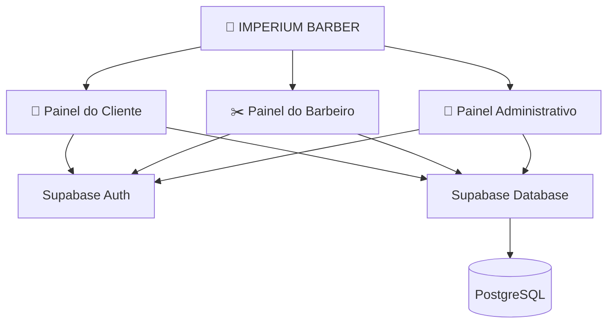
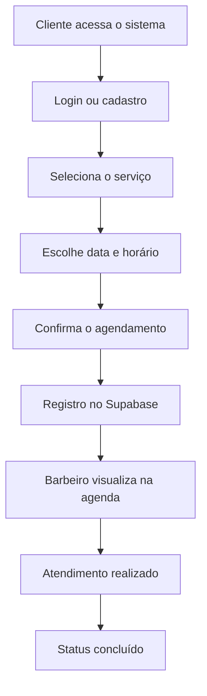

<div align="center">

# 👑 IMPERIUM BARBER

### ✦ BARBERSHOP MANAGEMENT SYSTEM ✦

**TRADIÇÃO NO ESTILO. INOVAÇÃO NA EXPERIÊNCIA.**

<br>


<br>

Uma plataforma moderna de agendamento e gerenciamento para barbearias.

**Elegância, organização e tecnologia em um só lugar.**

<br>

[](https://github.com/pietromantuan-collab/imperium-barber)
[](https://github.com/pietromantuan-collab/imperium-barber/stargazers)

</div>

---

## 👑 SOBRE O PROJETO

O **Imperium Barber** é uma aplicação web desenvolvida para modernizar o gerenciamento de barbearias, oferecendo uma experiência completa de agendamento para clientes e organização para os profissionais.

O sistema foi idealizado para digitalizar processos, reduzir conflitos de horários e centralizar o gerenciamento dos atendimentos em uma única plataforma.

O projeto contempla três ambientes principais:

- 👤 **Painel do Cliente** — agendamentos e acompanhamento dos serviços.
- ✂️ **Painel do Barbeiro** — gerenciamento da agenda e dos atendimentos.
- 👑 **Painel Administrativo** — controle das operações da barbearia.

O desenvolvimento prioriza uma interface premium, navegação intuitiva, responsividade e segurança das informações.

---

## ✨ PRINCIPAIS FUNCIONALIDADES

### 👤 Painel do Cliente

| Funcionalidade | Descrição |
|---|---|
| 🔐 Autenticação | Cadastro e login com e-mail e senha |
| 👤 Perfil | Gerenciamento das informações pessoais |
| ✂️ Serviços | Visualização dos serviços disponíveis |
| 📅 Agendamento | Escolha de serviço, data e horário |
| 🕒 Horários | Consulta aos horários disponíveis |
| 📋 Histórico | Acompanhamento dos agendamentos |
| ❌ Cancelamento | Cancelamento conforme regras definidas |
| 📱 WhatsApp | Abertura de mensagens prontas para envio |

### ✂️ Painel do Barbeiro

| Funcionalidade | Descrição |
|---|---|
| 📊 Dashboard | Visão geral dos atendimentos |
| 📅 Agenda | Visualização dos horários agendados |
| 👥 Clientes | Consulta dos clientes agendados |
| ✅ Status | Controle dos atendimentos realizados |
| 🕒 Horários | Gerenciamento da disponibilidade |
| 📈 Indicadores | Resumo dos atendimentos |

### 👑 Painel Administrativo

| Funcionalidade | Descrição |
|---|---|
| 📊 Dashboard | Visão geral do estabelecimento |
| 👥 Usuários | Gerenciamento de usuários |
| ✂️ Serviços | Cadastro e edição dos serviços |
| 📅 Agendamentos | Controle da agenda |
| ⚙️ Configurações | Definição dos horários de funcionamento |
| 💰 Faturamento | Valor estimado dos atendimentos concluídos |

> **Nota:** as funcionalidades apresentadas descrevem o escopo do projeto. Os recursos disponíveis dependem da etapa atual de desenvolvimento.

---

## 🛠️ TECNOLOGIAS

<div align="center">

### Front-end


### Back-end, autenticação e banco de dados


### Desenvolvimento e design


</div>

---

## 🏗️ ARQUITETURA DO SISTEMA

O projeto utiliza o **Supabase** como solução de back-end, permitindo integrar autenticação, armazenamento de dados e gerenciamento das informações da aplicação.

### Estrutura conceitual



### 🔐 Autenticação

O **Supabase Auth** é a solução escolhida para o gerenciamento de identidade dos usuários.

A arquitetura prevê:

- Cadastro com e-mail e senha.
- Login e logout.
- Gerenciamento de sessões.
- Recuperação de senha.
- Identificação dos usuários autenticados.
- Controle de permissões conforme o perfil.

### 🗄️ Banco de Dados

O projeto utiliza o **PostgreSQL**, disponibilizado pelo Supabase.

O armazenamento relacional permite organizar informações sobre clientes, serviços, profissionais e agendamentos.

O controle de acesso aos registros deve ser implementado com políticas de **Row Level Security (RLS)**.

---

## 🗃️ ESTRUTURA DO BANCO DE DADOS

Modelo conceitual das principais tabelas:

| Tabela | Finalidade |
|---|---|
| `users` | Dados e perfis dos usuários |
| `services` | Serviços, valores e duração |
| `appointments` | Registros dos agendamentos |
| `settings` | Configurações de funcionamento |

### Exemplo conceitual de agendamento

```json
{
  "user_id": "uuid-do-cliente",
  "service_id": "uuid-do-servico",
  "date": "2026-10-22",
  "time": "14:00",
  "status": "agendado"
}
```

Os nomes e campos devem corresponder ao esquema SQL efetivamente utilizado no projeto.

---

## 📅 FLUXO DE AGENDAMENTO



O fluxo foi planejado para centralizar os agendamentos e facilitar a rotina dos profissionais.

---

## 🎨 IDENTIDADE VISUAL

A identidade do **Imperium Barber** foi projetada para transmitir:

- 👑 Exclusividade.
- ✨ Sofisticação.
- ✂️ Tradição.
- 💻 Modernidade.
- 🖤 Elegância.

### Paleta de referência

| Cor | Hexadecimal | Utilização |
|---|---|---|
| ⚫ Preto | `#0B0B0B` | Fundo principal |
| 🟡 Dourado | `#D4AF37` | Destaques e detalhes |
| ◼️ Grafite | `#1A1A1A` | Cards e componentes |
| ⚪ Branco | `#F5F5F5` | Textos principais |
| 🔘 Cinza | `#9CA3AF` | Informações secundárias |

O objetivo é construir uma identidade digital que represente o posicionamento premium da barbearia.

---

## 💻 COMO EXECUTAR

### 1. Clone o repositório

```bash
git clone https://github.com/pietromantuan-collab/imperium-barber.git
```

### 2. Acesse a pasta

```bash
cd imperium-barber
```

### 3. Configure o Supabase

Acesse:

https://supabase.com/dashboard

No seu projeto Supabase:

1. Verifique as tabelas utilizadas pela aplicação.
2. Configure a autenticação por e-mail e senha.
3. Confira as políticas de segurança RLS.
4. Localize a URL do projeto e a chave pública apropriada.
5. Configure as credenciais no local esperado pelo código.

Exemplo ilustrativo:

```javascript
const supabaseUrl = "SUA_SUPABASE_URL";
const supabaseKey = "SUA_CHAVE_PUBLICAVEL";
```

**Atenção:** nunca exponha a chave `service_role` ou uma chave secreta do Supabase no código do navegador.

### 4. Execute o projeto

Inicie a aplicação utilizando o servidor local ou o comando de desenvolvimento correspondente à estrutura do repositório.

Para uma aplicação estática, é possível utilizar o Live Server do VS Code.

---

## 🔒 SEGURANÇA

A segurança da plataforma considera:

- Autenticação dos usuários pelo Supabase.
- Controle de acesso baseado em perfis.
- Políticas RLS no PostgreSQL.
- Proteção das informações pessoais.
- Validação de permissões administrativas.
- Validação de disponibilidade dos horários.
- Proteção contra acesso indevido aos agendamentos.

As regras de acesso precisam ser testadas antes da publicação em produção.

---

## 🚀 ROADMAP

### Desenvolvimento da plataforma

- [ ] Finalização da interface do cliente.
- [ ] Finalização do painel do barbeiro.
- [ ] Finalização do painel administrativo.
- [ ] Integração completa com Supabase Auth.
- [ ] Integração com PostgreSQL.
- [ ] Controle de permissões dos usuários.
- [ ] Cadastro e gerenciamento de serviços.
- [ ] Gerenciamento dos agendamentos.
- [ ] Validação de conflitos de horário.
- [ ] Relatórios e indicadores.
- [ ] Testes funcionais.
- [ ] Testes de segurança.
- [ ] Otimização para dispositivos móveis.
- [ ] Publicação da versão estável.

> Os itens podem ser marcados conforme cada etapa for concluída e validada.

---

## 🔮 MELHORIAS FUTURAS

Funcionalidades consideradas para futuras versões:

- 🔔 Notificações automáticas.
- 📲 Integração aprimorada com WhatsApp.
- ⭐ Sistema de avaliação.
- 🎁 Programa de fidelidade.
- 💳 Pagamentos online.
- 📊 Relatórios financeiros.
- 📅 Integração com calendários.
- 📱 Melhorias na experiência mobile.

---

## 👨‍💻 DESENVOLVEDOR

<div align="center">

### Pietro Rodrigues Torresani Mantuan

**Desenvolvimento de Software | Aplicações Web | Tecnologia**

Responsável pelo desenvolvimento do projeto **Imperium Barber**, com foco na criação de soluções digitais modernas, funcionais e intuitivas.

<br>

[](https://github.com/pietromantuan-collab)

</div>

---

## 🤝 CONTRIBUIÇÕES

Contribuições, sugestões e melhorias são bem-vindas.

Para colaborar:

1. Faça um fork do repositório.
2. Crie uma branch para sua alteração.
3. Implemente suas modificações.
4. Abra um Pull Request.

---

<div align="center">

# 👑 IMPERIUM BARBER

### MORE THAN A HAIRCUT. AN EXPERIENCE.

**MAIS DO QUE UM CORTE. UMA EXPERIÊNCIA.**

<br>

*Tradição • Elegância • Tecnologia*

<br>

Desenvolvido por **Pietro Rodrigues Torresani Mantuan**

<br>


</div>
